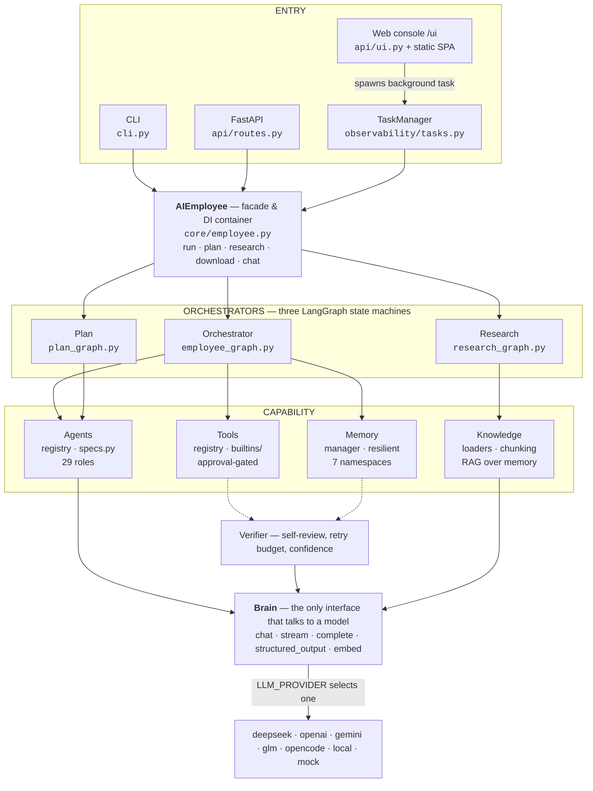
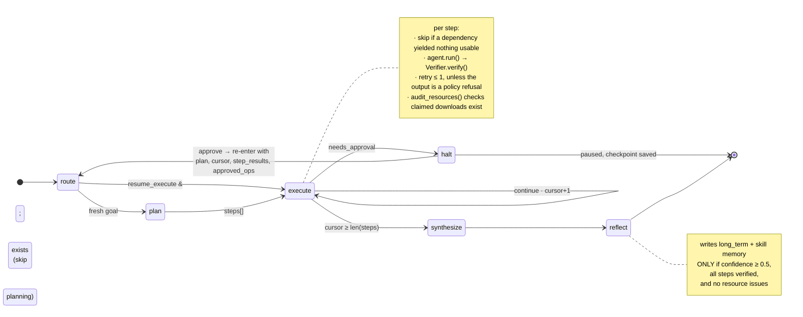
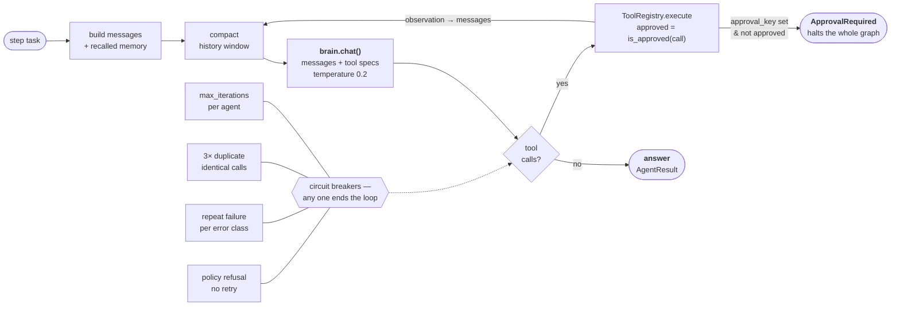
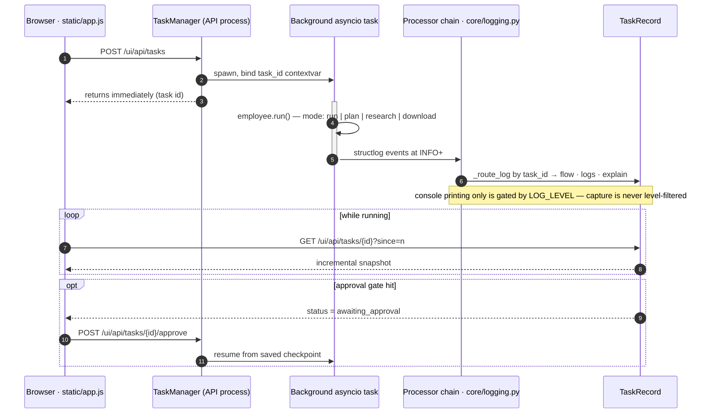

# Architecture diagrams

Companion to [architecture.md](architecture.md), which carries the prose. This file
carries the pictures: the layered module map, the LangGraph state machine, the agent's
ReAct loop, and the runtime path of one task through the web console.

Diagrams describe the code **as committed** (`src/ai_employee/`), not an aspirational
design. A richer, styled version of the same four diagrams is in
[architecture-diagrams.html](architecture-diagrams.html) — open it in a browser.

Counts as of this writing: **29 agents**, **24 tools** (29 with Google Workspace
connected), **7 providers**, **3 orchestrators**, **7 memory namespaces**, **25 MCP
connector presets**.

---

## 1. Layered structure

Dependencies point downward only. `Brain` is the choke point every model call passes
through — swapping `LLM_PROVIDER` changes the whole system's reasoning engine without
touching a line above it.

Every arrow is a compile-time import direction. Nothing above the `Brain` band knows
which provider is loaded — `brains/factory.py` is the single place that maps a name to a
class, which is what makes the `mock` provider a complete offline substitute rather than
a stub.

---

## 2. The execution graph

The main `Orchestrator` is a LangGraph state machine over a typed `EmployeeState`. The
interesting part is not the happy path — it is the two ways a run leaves the loop early,
and the state that survives when it does.

The **halt path** is what makes long-running work survivable: the run stops mid-plan,
`checkpoint_from_state` serializes cursor and results, and approval re-enters at
`execute` rather than re-planning from scratch. The **reflect** node is deliberately
conservative — an unverified or low-confidence run teaches the system nothing rather
than poisoning recall.

---

## 3. Inside a step: the agent loop

Each `execute` node hands one step to a `ToolUsingAgent` (`agents/base.py`) — a ReAct
loop bounded on four separate axes, because an unbounded tool loop is the default
failure mode of this architecture.

The loop's exit conditions carry the engineering. A duplicate-call counter, a
per-error-class failure counter, and a refusal detector each break out with a `[SYSTEM]`
nudge injected into the observation, so the agent synthesizes from what it already has
instead of burning the iteration budget. The **approval branch** does not return an
error — it raises through the agent and the graph node alike, which is why a sensitive
tool can pause a whole multi-step run.

---

## 4. Runtime path of one task

The console never blocks on a run. `TaskManager` launches the pipeline in its own
asyncio task with a `task_id` bound to the logging context; the SPA polls a snapshot
cursor. That contextvar is the entire mechanism by which deeply nested log events find
the right browser tab.

Log capture is intentionally decoupled from console verbosity: `INFO` and above always
reach the processor chain so observers can attribute them, and only *printing* is
filtered by `LOG_LEVEL`. Reintroducing level filtering at the `wrapper_class` would
silently blank the dashboard's live flow while leaving every test green.

---

## Invariants the design rests on

These are not style preferences — each one is load-bearing, and violating it breaks a
property the rest of the architecture assumes.

| Invariant | What it means |
|---|---|
| **No SDK above the Brain** | Business logic never imports an LLM SDK. Provider knowledge lives in `brains/providers/` and `brains/factory.py`, nowhere else. |
| **Config, not code** | `LLM_PROVIDER` is the single switch. No module branches on provider identity to change behavior. |
| **Offline is first-class** | `mock` brain + `mock` embeddings + in-memory store must run the full pipeline with no network and no database. The test suite enforces it. |
| **Async all the way down** | Public APIs are `async`; nothing blocks the event loop, because the task runner shares it with the API process. |
| **Sensitive ops are gated** | A tool with an `approval_key` in `approval_required` cannot execute without `approved=True` — the gate is in the registry, not in any agent's prompt. |

Approval keys currently enforced: `db_write`, `deploy`, `email_send`, `git_push`,
`resource_acquisition`, `resource_download`, `shell_write`, `calendar_write`, `mcp_tool`.
