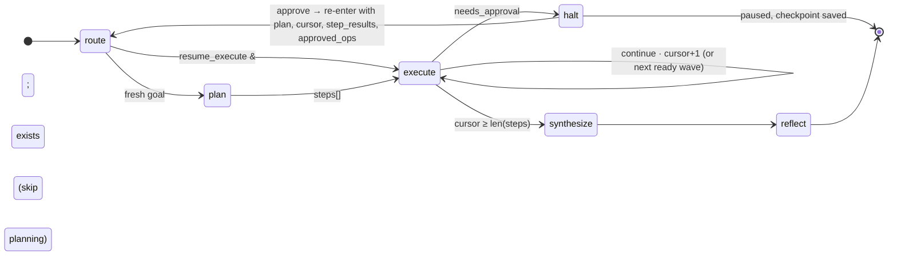
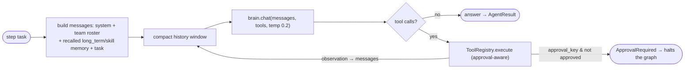
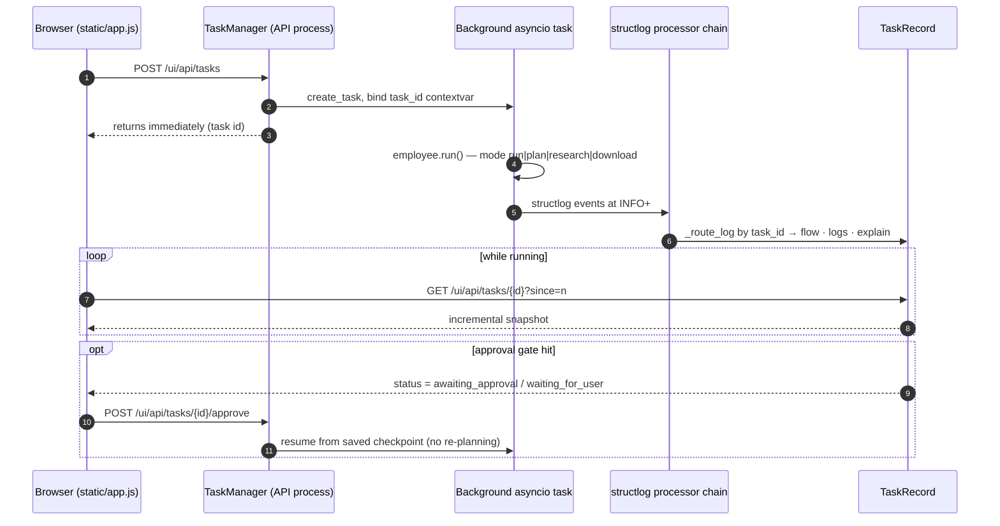

# How the AI Employee Framework works — the complete, code-verified guide

> **Who this is for.** Anyone who wants to understand *everything* this project does:
> where a goal enters, how it becomes a plan, how each step is executed by a
> specialized agent, which model calls happen, which tools run and where they are
> gated, what is verified, what is remembered, and where every byte of state lives on
> disk. No prior reading required — this document is self-contained.
>
> **How it was written.** Every claim below was checked against the source in
> `src/ai_employee/` at commit `8c27203` (plus working-tree changes). Where a claim
> comes from code, the file is named so you can open it and confirm. Where the older
> diagrams/docs disagree with the code, this document says so and gives the real value
> (see [§0](#0-do-the-existing-diagrams-match-the-code)).

---

## 0. Do the existing diagrams match the code?

You asked a precise question: *if you read the architecture diagram and then the code,
do they match?* Mostly yes — the **shape** of the design (layers, the Brain boundary,
the `plan → execute → synthesize → reflect` graph, the approval-halt path) is accurate.
A handful of **counts and one roster** drifted as features were added. These are the
only substantive discrepancies found:

| Thing | Older docs say | Code says (verified) | Where |
|---|---|---|---|
| Agents | `agent-flow.md` says **23** ("20 declarative + 3 bespoke") | **29** registered | `agents/specs.py` (26 specs) + `agents/custom.py` (`planner`, `ceo`, `human_approval`) |
| Tools | `architecture-diagrams.md` says **23**; README says **24** | **24** base (filesystem + code + web + research + resource), **+5** Google (Gmail/Calendar) when OAuth is configured → **29 total** | `tools/builtins/__init__.py`, `tools/builtins/google_workspace.py` |
| Tests | README badge says **266** | **333** collected across **30** test files | `pytest --collect-only` |
| Approval keys | `architecture-diagrams.md` lists 7 | **9** defaults: `shell_write, email_send, git_push, db_write, deploy, resource_download, resource_acquisition, mcp_tool, calendar_write` | `config/settings.py::require_approval_for` |
| MCP connectors | "popular servers" (unnamed count) | **25** presets in the catalog | `tools/mcp/catalog.py` |

Everything else in the diagrams — 3 orchestrators, 7 memory namespaces, 7 LLM
providers, the module arrows, the halt/resume path, the ReAct loop with its circuit
breakers, and the SPA polling `TaskRecord` — matches the code. The corrected numbers
are used throughout this document.

Verified by running the offline build:

```
$ LLM_PROVIDER=mock python -m ai_employee agents   # agents.ready count=29, employee.ready agents=29 tools=29
$ LLM_PROVIDER=mock python -m ai_employee tools    # 29 tools listed
$ pytest --collect-only -q                          # 333 tests across 30 files
```

---

## 1. The system in one paragraph

The framework turns a **high-level goal** into a finished result by treating an LLM
as one replaceable part of an assembly line. A **facade** (`AIEmployee`) wires together
a swappable **Brain** (the only thing that talks to a model), a registry of **29
specialized agents**, **29 built-in tools** (plus any MCP connectors you enable), a
**memory** system, a **knowledge/RAG** system, and a **verifier**. A **LangGraph state
machine** (`Orchestrator`) drives the loop `plan → execute* → synthesize → reflect`.
Every step is executed by a **ReAct agent** (reason → call tools → observe → answer),
**verified** by an independent reviewer, and — if it used a sensitive tool — **paused
for human approval**. The whole run is checkpointed so it survives a restart. A
dependency-free **web console** streams the live flow, logs, and every LLM round-trip.

---

## 2. The 10,000-foot map

### 2.1 Layers (dependencies point down; nothing below `brains/` knows the vendor)

```
ENTRY POINTS
  CLI (cli.py)          REST API (api/routes.py)      Web console (api/ui.py + static SPA)
  ⏰ Scheduler (observability/schedules.py)            👤 Accounts (api/users.py)
        │                        │                              │
        └────────────────────────┴──────────────┬───────────────┘
                                                 ▼
        AIEmployee  — facade & DI container  (core/employee.py)
        run · research · plan · download · chat · ask_agent · memory mgmt
                                                 │
        ┌────────────────────────────────────────┼─────────────────────────────┐
        ▼                    ▼                    ▼                             ▼
  Orchestrator         PlanOrchestrator     ResearchOrchestrator        Observability
  (employee_graph.py)  (plan_graph.py)      (research_graph.py)        (TaskManager, store,
   plan→exec→synth→     research→synth→      discover→decide→          audit, usage, asset
   reflect              assemble             [hardware]→generate→      registry, notify)
        │                                     [run]→assemble
        ▼
  CAPABILITY  ┌──────────────┬───────────────┬───────────────┬──────────────┐
              │ Agents(29)   │ Tools(29+)    │ Memory(7 ns)  │ Knowledge    │
              │ registry +   │ registry +    │ in-mem /      │ loaders +    │
              │ specs        │ builtins +    │ pgvector /    │ chunking +   │
              │              │ MCP + approval│ resilient     │ RAG          │
              └──────┬───────┴───────┬───────┴───────┬───────┴──────┬───────┘
                     │               │               │              │
                     └───────────────┴───────┬───────┴──────────────┘
                                             ▼
        Verifier — self-review, retry budget, confidence   (verification/)
                                             │
                                             ▼
        Brain — the ONE interface to any model   (brains/base.py)
        chat · stream · structured_output · embed · complete · capability flags
                                             ▼
        Providers: mock · deepseek · openai · gemini · glm · opencode · local
        (selected entirely by LLM_PROVIDER in config/settings.py + brains/factory.py)
```

The single most important rule: **business logic never imports an LLM SDK.** Every
model call goes through the `Brain` interface (`brains/base.py`). `brains/factory.py`
is the *only* module that maps a provider name to a class. That is what makes the
provider a configuration value — and what makes the `mock` provider a complete offline
substitute rather than a stub.

### 2.2 The three orchestrators (all LangGraph state machines)

| Orchestrator | File | Nodes / edges | Purpose |
|---|---|---|---|
| **Orchestrator** | `workflows/employee_graph.py` | `route → plan → execute* → synthesize → reflect` (+ `halt`) | The main "give it a goal, get a result" pipeline. |
| **PlanOrchestrator** | `workflows/plan_graph.py` | `research → synthesize → assemble` | Guide-only: research how to do a goal and produce a step-by-step how-to with tools. No code runs, nothing downloads. |
| **ResearchOrchestrator** | `workflows/research_graph.py` | `discover → decide → [hardware] → generate → [run?] → assemble` | ML-problem decision tree: find model/dataset/paper, estimate VRAM, generate the right code, optionally run it (approval-gated). |

---

## 3. The Brain abstraction — the one interface to any model

**File:** `brains/base.py`. Docstring: *"Every provider implements this identical
interface… so the provider can be swapped through configuration alone."*

### 3.1 The contract

```python
class Brain(abc.ABC):
    name: str = "brain"          # stable provider id, e.g. "deepseek"
    model_name: str = ""         # active chat model, shown in /config and the UI

    # capability flags (callers degrade gracefully based on these)
    supports_tools: bool = True
    supports_streaming: bool = True
    supports_structured_output: bool = True
    supports_embeddings: bool = False
    supports_reasoning: bool = False

    async def chat(messages, *, tools=None, temperature=None,
                   max_tokens=None, model=None, reasoning=False) -> ChatResult
    async def stream(messages, ...) -> AsyncIterator[str]          # default = one chat
    async def structured_output(messages, schema, ...) -> BaseModel # default = JSON prompt
    async def embed(texts) -> list[list[float]]                     # default = NotImplemented
    async def complete(prompt, *, system=None, **kw) -> str         # convenience
    async def aclose() -> None
```

- **`structured_output`** is the workhorse for the Planner, the Verifier, the research
  Discovery, and the Plan guide. The base implementation appends a JSON-schema
  instruction as a *second* system message, calls `chat`, extracts JSON (tolerating
  ```` ```json ```` fences), validates it against the Pydantic model, and — importantly —
  records its own token usage (a metering wrapper above it would never see this nested
  call). Providers that support native JSON mode (below) override it.
- **`_extract_json`** strips markdown fences and falls back to a balanced-brace scan, so
  models that wrap JSON in prose still parse.

### 3.2 Schemas (`brains/schemas.py`)

The message/tool shapes are deliberately the *common denominator* of OpenAI, DeepSeek,
Gemini and GLM so nothing above the Brain changes when you switch:

- `Role` — `system | user | assistant | tool`
- `Message` — `role`, `content`, `tool_call_id`, `tool_calls: list[ToolCall]`, `name`;
  constructors `Message.system()/.user()/.assistant()/.tool()`
- `ToolSpec` — `name`, `description`, `parameters` (a JSON schema); `to_openai()` shapes
  it for the Chat Completions dialect
- `ToolCall` — `id`, `name`, `arguments: dict`
- `Usage` — `prompt_tokens`, `completion_tokens`, `total_tokens`
- `ChatResult` — `content`, `tool_calls`, `finish_reason`, `model`, `usage`,
  `extra` (provider-specific, e.g. DeepSeek `reasoning_content`); `has_tool_calls`

### 3.3 The provider wrapper stack

`get_brain()` (`brains/factory.py`) always returns:

```
ExplainBrain(  MeteredBrain(  <provider>  )  )
   │              │
   │              └─ innermost: counts tokens on every call; enforces the token budget
   └─ outermost: captures input/output of every call for the Explain tab
```

- **`MeteredBrain`** (`brains/metering.py`) records each `chat` call's `Usage` into the
  active `TokenMeter` and calls `_enforce_budget()` *before* each call. Because
  enforcement lives **outside the model**, no prompt can talk the system past its cap —
  once the budget is exhausted, every further call raises `BudgetExceeded`.
- **`ExplainBrain`** (`brains/instrument.py`) logs `brain.request` / `brain.response`
  events (last 16 messages, tool names, output) so the dashboard's **Explain** tab can
  show exactly what each component sent and received. Enabled by `EXPLAIN_TRACE`
  (default `true`). Both wrappers mirror identity and capability flags, so they are
  transparent to everything above.

### 3.4 The seven providers

| `LLM_PROVIDER` | Class | Chat model (default) | Reasoning | Embeddings | Base URL |
|---|---|---|---|---|---|
| `mock` | `MockBrain` | `mock-1 (offline)` | ✓ | ✓ (hash-based) | — |
| `deepseek` *(default)* | `DeepSeekBrain` | `deepseek-chat` | `deepseek-reasoner` | — | `https://api.deepseek.com` |
| `openai` | `OpenAIBrain` | `gpt-4o` | `o3-mini` | `text-embedding-3-small` | `https://api.openai.com/v1` |
| `gemini` | `GeminiBrain` | `gemini-2.5-pro` | — | `gemini-embedding-001` | Google OpenAI-compat endpoint |
| `glm` | `GLMBrain` | `glm-4-plus` | — | `embedding-3` | `https://open.bigmodel.cn/api/paas/v4` |
| `opencode` | `OpenCodeBrain` | `deepseek-v4-pro` | reuse chat | — | `https://opencode.ai/zen/v1` |
| `local` | `LocalBrain` | `qwen3:8b` | `qwen3:8b` | `Qwen3-Embedding-8B:Q4_K_M` | `http://localhost:11434/v1` (Ollama) |

- **`MockBrain`** is deterministic and fully offline. It synthesizes structured output
  by *reading the JSON schema out of the system prompt*, makes a tool call for the first
  advertised tool when the user text looks actionable (`run/execute/search/read/write/
  fetch/list/create/query`), and produces stable hash-based embeddings. This is why the
  entire pipeline and every test run with **no network and no API keys**.
- **`OpenAICompatibleBrain`** (`brains/providers/openai_compatible.py`) is one robust
  implementation shared by DeepSeek/OpenAI/Gemini/GLM/OpenCode/Local: tenacity retries
  with exponential backoff on connection/timeout/rate-limit/5xx, tool-call parsing,
  native JSON mode for `structured_output` (with fallback), embeddings, streaming, and
  two hardening quirks worth knowing:
  - **Inline-tool-markup recovery** — some DeepSeek models leak tool calls as `DSML`
    text instead of structured `tool_calls`. The parser detects this and recovers the
    calls, so the agent loop doesn't treat markup as a final answer.
  - **`<think>` separation** — Qwen3 emits `thinking` blocks; these are moved out of
    `content` into `extra["reasoning_content"]` so agents see clean output, and a
    `/no_think` hint is sent for local models unless reasoning was explicitly requested.

> **Gotcha:** `EMBEDDING_PROVIDER` is separate from `LLM_PROVIDER` on purpose. DeepSeek
> and OpenCode have no embeddings endpoint, so RAG/long-term memory use
> `EMBEDDING_PROVIDER` (default `openai`). `get_embedder()` reuses the chat brain if it
> embeds; otherwise it builds the separate embedder.

---

## 4. The facade: `AIEmployee`

**File:** `core/employee.py`. This is the single entry point most users touch.

### 4.1 What `__init__` wires (in order)

1. `configure_logging(...)`.
2. **Overlay UI-managed state onto settings** — `apply_secrets()` (keys added from the
   🔑 Keys panel) and `apply_ui_preferences()` (provider/model, coding backend,
   parallel, memory toggle chosen in the console).
3. Register the **usage-ledger sink** (every metered call is written to
   `data/usage_ledger.jsonl`).
4. Build `self.brain` and `self.embedder` (via the factory).
5. Build `self.tools` (`default_registry` = built-ins + enabled MCP connectors).
6. Build `self.agents` (`build_agent_registry`).
7. Build `self.memory` (`build_memory_manager`) and **restore** persisted memory.
8. Build `self.knowledge` (`KnowledgeBase`).
9. Build the three orchestrators (`Orchestrator`, `ResearchOrchestrator`,
   `PlanOrchestrator`).

It logs `employee.ready` with the agent and tool counts.

### 4.2 Public methods

| Method | What it does |
|---|---|
| `await run(goal, *, session_id, approved_ops, resource_decision, workflow_checkpoint, session_context, base_agent, on_progress)` | The full pipeline. `base_agent` is **opt-in**: pass a name to pin every step to one agent; leave it `None` (default) for the normal multi-agent run where the planner assigns each step to the best specialist. The **model is frozen per run**: the brain selected when the run is launched is used by every agent in it, and switching the brain for a later task never affects a run that is still executing. Returns `{goal, base_agent, brain_provider, brain_model, answer, confidence, plan, steps, tokens, needs_approval, trace, workflow_checkpoint}`. |
| `await research(goal, *, auto_run)` | The ML research decision tree (see §5.3). |
| `await plan(goal)` | The how-to guide (see §5.2). |
| `await download(goal, *, approved_ops, resource_decision)` | Runs the `research` agent directly on URLs in the goal, with a "download these URLs, don't search" brief (normalizes a bare URL into a download task). |
| `await chat(message, *, session_id)` | Single-turn chat with conversation memory. No planning. |
| `await ask_agent(name, task, *, session_id)` | Runs one named agent directly, skipping the pipeline. |
| `await name_task(goal)` | A tiny (~24-token) LLM call for a short human task title; best-effort with a truncation fallback. |
| `persist_memory()` / `_restore_memory()` | Dump/restore the in-memory store to `data/sessions/_memory.jsonl`. |
| `clear_memories()` / `restore_memories()` / `memory_status()` / `clear_session_memory(sid)` | Memory administration (backs up before clearing). |
| `await aclose()` | Persist memory, close brain + embedder. |

`on_progress` is the resume hook: the orchestrator calls it with a serializable
checkpoint after every node, which is how a run stopped mid-flight stays resumable.

---

## 5. The orchestrators (the engines)

### 5.1 The main Orchestrator

**File:** `workflows/employee_graph.py`.

#### State (`EmployeeState`)

A `TypedDict` whose fields carry **reducer annotations** so LangGraph merges correctly
across the loop:

- `step_results` and `trace` **append** (`old + new`)
- everything else **keeps the newest** (`cursor`, `final`, `confidence`,
  `needs_approval`, `resource_decision`, `approved_ops`, `resume_execute`, `plan`, …)

#### The graph



Routing:
- `_route_start` → `execute` if resuming with a plan, else `plan`.
- `_route_after_execute` → `halt` if `needs_approval`, `synthesize` if the cursor
  passed the last step, else `continue`.
- `recursion_limit = 50` guards against pathological plans.

#### Node: `plan`

`bind_context(node="plan")`; if resuming, logs `workflow.resume_skip_plan` and returns.
Otherwise it builds an `AgentContext` (with the agent catalog in `scratch`), runs the
`planner` agent on `goal + session_context`, extracts `metadata["plan"]`, and returns
`{plan, cursor: 0, step_results: [], trace}`.

**Multi-agent by default.** The general `task` run passes no `base_agent`, so the
planner assigns each step to the best-fit specialist from the catalog. Passing
`base_agent=...` (opt-in) pins the run instead: the planner is shown only that
agent's roster line and is told to assign every step to it, and after planning
every step's `agent` field is forced to the base agent
(`workflow.base_agent_pinned`). The single-purpose modes map to their owner in
`agents/routing.py` (`research → research`, `plan → planner`,
`download → research`).

#### Node: `execute` — sequential or parallel

`execute` dispatches on the `PARALLEL_STEPS` setting:

- **Sequential** (default): runs `steps[cursor]`, appends one record, `cursor+1`.
- **Parallel** (`_execute_parallel_node`): *greedy, not wave-locked.* It repeatedly asks
  the pure scheduler (`workflows/scheduler.py`) for `ready_steps` (dependencies met,
  not done/running), launches up to `max_parallel_steps` (default 4) as asyncio tasks,
  and starts a newly-unblocked step **the instant** its dependency finishes — rather
  than waiting for the rest of a wave. A step whose deps aren't met stays pending. One
  step failing never kills the run. If an approval halt occurs, in-flight steps are
  still awaited so their results aren't thrown away.

Both paths funnel into `_run_one_step`, so the semantics are identical.

#### `_run_one_step` — the heart of execution

1. `bind_context(node="execute", step, agent)` — bound **per step**, because each
   parallel step runs in its own asyncio task; this is what attributes every nested log
   event (`agent.start`, `brain.request`, `tool.execute`, `verifier.*`) to the right
   step in the Explain tab.
2. **Dependency gate** — if a prerequisite step produced nothing usable
   (`_looks_unusable`) and `SKIP_ON_FAILED_DEPENDENCY` is on, emit a *skip record*
   instead of hallucinating on it.
3. Resolve the agent, format prior-step context, build the task string, and run
   `agent.run(task, ctx)`.
4. If the agent produced < 20 chars but did call tools, synthesize the output from the
   tool trace so downstream steps aren't starved.
5. **Approval halt** — if `result.needs_approval`, return a `halt` (unless it's a
   `waiting_for_user` case already satisfied by prior successful downloads or a granted
   `resource_acquisition`).
6. **Resource audit** (`audit_resources`) — checks the output against real URLs,
   download attempts, and files on disk. A `waiting_for_user` outcome halts with a
   payload the UI renders as *provide a local path / URL / proceed / abort*.
7. **Artifact audit** (`audit_artifacts`) — independently cross-checks every
   byte-count/line-count/pixel-dimension claim against the real file on disk.
8. **Verify + bounded retry** — `Verifier.verify(...)` returns a `Verdict`; failed steps
   retry at most `max_retries_per_step` (default **1**) with the reviewer's feedback.
   Retries are skipped for policy refusals (`_looks_like_refusal`) and stop early if the
   retry produces essentially the same answer (stalled).
   **Provider rate limits** (HTTP 429 / quota) are handled inside the Brain with a
   longer, capped backoff that honors `Retry-After`. Each sleep logs
   `brain.rate_limited` with a `retry_at`; the task status becomes `cooling` and the
   console shows *“Cooling down — rate limit … retrying at HH:MM:SS”*. When the
   retry succeeds, `brain.rate_limit_cleared` returns the status to `running`.
   Connection/timeout/5xx errors keep the shorter `llm_max_retries` backoff.
9. Emit the step record: `{id, description, agent, output, confidence, verified,
   retries, resource_audit}`.

#### Node: `synthesize`

Runs the `ceo` agent with all step results in `scratch`. The CEO labels every step
`[COMPLETED]` / `[UNVERIFIED]` / `[SKIPPED — do not treat this step's deliverable as
produced]`, and is told explicitly not to reconstruct deliverables that a skipped step
was supposed to build. It also injects audited resource blocks and a strict resource
reporting format for resource tasks. `confidence` for the run is the mean of the step
confidences.

#### Node: `reflect` — learn, conservatively

Writes to `long_term` memory and distills a reusable **skill** *only if all* of:
`use_stored_memory` is on, run confidence ≥ 0.5, no resource-audit issues, and no
unverified steps. A low-confidence or unverified run teaches the system nothing rather
than poisoning recall.

### 5.2 PlanOrchestrator (`workflows/plan_graph.py`)

Guide-only: research how to achieve a goal and produce a structured `PlanGuide`
(`summary`, `approach`, `tools` with `kind = open_source|proprietary|freemium|saas|
unknown`, `steps`, `alternatives`, `risks`). It runs `research` with download/write
tools denied (`NO_ACQUISITION_TOOLS`), synthesizes via structured output, normalizes ids, and assembles tools into
open-source vs proprietary buckets. **No code runs and nothing downloads.**

### 5.3 ResearchOrchestrator (`workflows/research_graph.py`)

The ML-problem decision tree:

```
discover → decide → [hardware] → generate → [run?] → assemble
```

- **discover** — the `research` agent (download tools denied) searches HF/PapersWithCode/Kaggle/arXiv/GitHub;
  findings are coerced into a typed `Discovery` (the coercion prompt forbids inventing
  ids; an empty Discovery = "found nothing").
- **decide** — pure Python picks a branch: `both` (model+dataset) → eval script;
  `model_only` → inference pipeline; `data_only` → training script; `neither` →
  reproduce-from-paper.
- **hardware** — runs only if a model was found; `research` estimates VRAM with `estimate_hardware`.
- **generate** — `coding` writes the appropriate code + README into the workspace, using only the resources discovery found (it has no web access).
- **run** — *approval-gated* by the key `run_research_code`; without it, `assemble`
  surfaces an approval request and stops instead of executing.
- **assemble** — a structured `ResearchResult` for the UI (found model/dataset/papers,
  hardware, generated code, accuracy if it ran, a branch-specific summary).

---

## 6. Agents

### 6.1 `ToolUsingAgent` — the ReAct loop

**File:** `agents/base.py`. This single implementation powers almost every specialized
agent; behavior is shaped by `system_prompt` + `allowed_tools`.



Inputs are logged as `agent.context` (system prompt, recalled memories, task) — this is
what the Explain tab shows as "what the agent was asked."

**Four circuit breakers** end the loop so an unbounded tool loop can't burn the budget:

1. **`max_iterations`** per agent (specs set 8–14).
2. **3× duplicate identical calls** — the tool-invocation history returns a
   `duplicate` payload with a *next-step hint* instead of re-running; at 3 duplicates a
   `[SYSTEM]` nudge is injected (resource agents are told to stop searching and actually
   download).
3. **Repeat failure per error class** (`agent_repeat_failure_limit`, default 2) — e.g.
   repeated `IndentationError`. Special recoverable classes (`UnicodeDecodeError`,
   `InvalidToolArgs`) get a targeted hint and do **not** abort.
4. **Policy refusal** — no retry.

When the loop ends by force, `_final_answer()` always forces a non-empty step output
(asking the model to answer briefly, retrying once, then falling back to a tool-trace
digest) so dependent steps aren't skipped for want of an answer.

**Approval inside the loop:** a tool call that raises `ApprovalRequired` is either
re-run with `approved=True` (if the op was pre-approved) or batched into a single
`needs_approval` result that propagates up and halts the graph.

**Confidence** is a cheap heuristic from the tool trace and answer length/hedging
(`_estimate_confidence`); the Verifier refines it.

`SimpleLLMAgent` is the trivial subclass with `allowed_tools = []` (pure reasoning).

### 6.2 The roster — 8 workers + 3 orchestration roles

**8 declarative `AgentSpec`s** in `agents/specs.py` (role, prompt, allowed tools,
`max_iterations`) — the registry instantiates a `ToolUsingAgent` for each. One of them,
`coding`, is instantiated as the custom `CodingAgent` (below). **Plus 3 bespoke classes**
in `agents/custom.py`. Each kind of work has exactly one owner:

| Agent | Owns |
|---|---|
| `research` | web research, hub search (HF/PwC/arXiv/Kaggle/Roboflow/GitHub/YouTube), downloads, `estimate_hardware` |
| `coding`* | local code, infra (Docker/CI/deploy), SQL/schemas, ML scripts — no web tools |
| `testing` | tests + pass/fail QA |
| `git` | version control |
| `data_analysis` | data fetching-by-code, EDA, charts |
| `documentation` | prose docs and notes |
| `reviewer` | read-only code / security / ops review |
| `comms` | Gmail + Calendar; `requires="google"`, so it is left out of the planner's roster until Google is connected |
| **bespoke (custom.py)** | `planner`, `ceo`, `human_approval` — never assignable as a step (`INTERNAL_AGENTS`) |

The roster was consolidated from 26 specialists on 2026-10-22. `LEGACY_AGENT_ALIASES`
(`agents/routing.py`) maps every retired name to its successor, so old checkpoints,
pinned `base_agent`s, per-agent limits in `.env`, and LLM output that remembers the old
names all keep working; saved runs still display the name that actually ran.

\* `coding` is a spec but is instantiated as `CodingAgent` so its backend is switchable.

### 6.3 The bespoke agents (`agents/custom.py`)

- **`CodingAgent`** — behaves like any tool-using agent when `CODING_BACKEND=brain`
  (default). When set to `claude`, `codex`, or `cursor`, it delegates the whole task to
  that external CLI, which writes **and runs** the code in the workspace
  (`integrations/code_agents.py`). A missing/unauthenticated CLI degrades to a clear
  message rather than crashing the run.
- **`PlannerAgent`** — wraps `planning/planner.py::Planner`; returns the plan JSON.
- **`CEOAgent`** — frames the goal (no steps yet) or synthesizes the final answer from
  labeled step results, with strict "never embellish snippets into downloads" rules.
- **`HumanApprovalAgent`** — represents the human gate; if the op is already in
  `approved_ops` it succeeds (so approve → resume doesn't loop forever), else it returns
  `needs_approval`.

### 6.4 The roster message

Before acting, every agent is given a **teammate roster** (`_roster_message`) and told to
do only its own part, naming the teammate that should handle anything else — this keeps
a `coding` step from moonlighting as `data_analysis` just because it has the tool.

---

## 7. Tools

### 7.1 The `Tool` contract (`tools/base.py`)

```python
class Tool(abc.ABC):
    name: str = "tool"
    description: str = ""
    category: str = "general"
    approval_key: str | None = None          # checked against settings.approval_required
    Args: type[BaseModel] = _EmptyArgs        # THIS model IS the JSON schema shown to the LLM

    async def execute(**kwargs) -> ToolResult    # validates args, runs, never raises
    async def _run(self, args) -> ToolResult      # the tool's real work
    def requires_approval(self, arguments) -> str | None   # override for arg-dependent gating
    def to_spec(self) -> ToolSpec                 # name + description + Args JSON schema
```

- `execute()` unwraps truncated `_raw` args, validates against `self.Args`, times the
  call into `ToolResult.latency_ms`, and converts any exception into `ok=False` (so a
  tool never crashes the run). `ApprovalRequired` is re-raised.
- `ToolResult` = `{ok, output, error, latency_ms, metadata}`; `as_text()` renders it for
  the model.

### 7.2 The registry (`tools/registry.py`)

`ToolRegistry.execute(name, arguments, approved=False)` is where **every** tool call is
funnelled, and it enforces all cross-cutting behavior:

1. Look up the tool; ask `requires_approval(arguments)` for an approval key.
2. If the key is in `settings.approval_required` and the caller didn't pre-approve it,
   consult **`approval_policies.auto_allows(...)`** (rule-based auto-approval). If a
   policy grants it, proceed and audit as `approved_by="policy"`. Otherwise raise
   `ApprovalRequired` — the halt that pauses the whole graph.
3. **Duplicate guard** — if the identical `(tool, args)` already ran **in this agent's
   turn**, return a `duplicate` payload with a next-step hint instead of re-running.
4. Execute, log `tool.result`, and — for any sensitive tool — append to the **audit
   trail** via `record_action(..., approved_by in {human, policy, auto})`.

Registration order in `default_registry`: built-ins first, then MCP proxy tools with
`replace=True` (`mcp_*`), so a connector can shadow a built-in name if it must.

### 7.3 The sandbox

`tools/builtins/_sandbox.py` confines every filesystem/data/code tool to
`WORKSPACE_DIR`: `resolve_in_workspace()` raises `ToolError("path … escapes the workspace
sandbox")` if a resolved path leaves the workspace.

### 7.4 The 29 built-in tools (24 base + 5 Google)

| Category | Tool (`name`) | Approval |
|---|---|---|
| filesystem | `read_file`, `list_dir` | — |
| filesystem | `write_file`, `make_dir` | `shell_write` |
| data | `csv_preview`, `json_query` | — |
| web | `http_request`, `fetch_page`, `web_search` | — |
| research (hubs) | `hf_search`, `paperswithcode_search`, `arxiv_search`, `github_search`, `kaggle_search`, `roboflow_search`, `estimate_hardware` | — |
| research (resources) | `youtube_search`, `hub_search_all`, `search_local_assets` | — |
| research (resources) | `download_resource` | `resource_download` |
| research (resources) | `request_resource_input` | dynamic: `waiting_for_user` / `resource_acquisition` |
| code | `python_exec` | — |
| code | `shell` | `shell_write` (read-only commands exempt) |
| code | `pip_install` | — (validated names only) |
| google* | `gmail_search`, `gmail_read`, `calendar_list_events` | — |
| google* | `gmail_send` | `email_send` |
| google* | `calendar_create_event` | `calendar_write` |

\* Google tools are **only registered when the operator's OAuth client file exists**
(`build_google_tools` returns `[]` otherwise), so default/offline installs never see
dead tools. That is why the count is "24 base, 29 with Google".

Notable behaviors:
- `list_dir(recursive=true)` returns the whole tree in one call (a hint in the tool
  description steers agents to `python_exec` for counting/measuring instead of walking
  level by level, which used to trip the duplicate-call guard).
- `download_resource` first checks the **asset registry** by URL — if the exact bytes are
  already in the workspace, it returns the local copy instead of re-downloading. This is
  the mechanism that guarantees a downloaded model/dataset is never fetched twice.
- `csv_preview` reports the file `encoding` to pass to pandas (many public CSVs are
  cp1252/latin-1, not UTF-8).
- `shell`'s `requires_approval` exempts a read-only allow-list (`ls, cat, head, grep,
  find, …`) and anything containing redirection/list operators.
- `search_local_assets` is read-only/offline and is meant to be called **before** any
  hub search or download.

---

## 8. Planning (`planning/planner.py`)

- **`PlanStep`** = `{id, description, agent, depends_on: list[int], success_criteria}`.
- **`Plan`** = `{goal, reasoning, steps}`; `.ordered()` sorts by id.
- `make_plan(goal, agent_catalog)` builds a strict planning prompt (smallest number of
  concrete steps; assign each to exactly one agent by `name`; **dependencies decide
  parallelism — be strict**, default `depends_on=[]`; only *direct* dependencies; two
  acquisition shortcuts; pick one resource modality; charts → `data_analysis`; no
  duplicated roles), appends the agent roster, and calls `structured_output(…, Plan)`.
- **Repair:** any step assigned to an unknown agent is rerouted to `research` (or the
  first valid agent) and logged `planner.invalid_agent`; an empty plan falls back to one
  step.
- **`prune_redundant_dependencies`** normalizes self/unknown/duplicate edges, breaks
  cycles (keeping 1-based backward edges), and removes transitive edges. Planners
  habitually over-link (`depends_on=[1,2,3]` when 3 already needs 1 and 2); those extra
  edges don't change order but would serialize work the ⚡ parallel executor could
  overlap.

---

## 9. Verification (`verification/`)

**Prose** (`verifier.py`): an independent, skeptical reviewer is asked whether the
OUTPUT satisfies the TASK + SUCCESS CRITERIA, returning
`Verdict {passed, confidence, issues, suggestion}` via structured output. It is wrapped
in `phase="verify"` context so the trace attributes the call to the verifier, and it
**never crashes a run** (any failure → `passed=True, confidence=0.5,
issues=["verifier unavailable"]`).

The verifier is fed two **deterministic ground-truth audits** (no LLM):

- **`audit_artifacts`** (`verification/artifacts.py`) — extracts every filename the
  output mentions, resolves it on disk, and records actual byte size / line count / PNG
  dimensions (read straight from the IHDR header — no Pillow needed). It then flags any
  byte/line/dimension claim that contradicts the file, any claimed file that doesn't
  exist, and any CSV whose date span is far short of a requested lookback ("last 1 year"
  but the file covers weeks). The verifier prompt is told these facts "were measured
  directly from disk and cannot be wrong."
- **`audit_resources`** (`verification/resources.py`) — classifies resource tasks as
  `completed` / `waiting_for_user` / `found_not_downloaded` / `not_found`. It checks real
  URLs and real files, not snippets; a `waiting_for_user` on a manual-download error
  (403/login/CAPTCHA/…) is a *pause*, not a failure, and the verifier is told to pass it
  when a suitable URL is documented. Post-verdict overrides enforce this.

Together these catch the failure mode where an agent's confident prose is arithmetically
wrong or claims a resource it never actually obtained.

---

## 10. Memory (`memory/`)

### 10.1 Seven namespaces (all one API)

`short_term · long_term · conversation · task · knowledge · project · skill`

A `MemoryRecord` = `{id, namespace, content, metadata, embedding, session_id,
created_at, score}`. Embeddings make semantic recall possible.

### 10.2 `MemoryManager` (`memory/manager.py`)

- `record(content, namespace, metadata, session_id)` — embeds (degrades to no-embedding
  on failure) and upserts.
- `record_message(role, content, session_id)` — conversation memory.
- `remember_skill(name, description, steps)` — the reusable-skill store.
- `recall(query, namespace, k, session_id)` — embeds the query and searches; if embedding
  fails it falls back to `recent()`.
- `conversation_window(session_id, limit)` — recent messages, chronological.
- `find_skill(query, k)`, `clear`, `clear_session`, `is_persistable`,
  `export_records`, `import_records`.

### 10.3 Backends (`build_memory_manager`)

| `MEMORY_BACKEND` | Store | Behavior |
|---|---|---|
| `memory` | `InMemoryVectorStore` | Pure in-process; cosine similarity in Python. Used by all tests. |
| `pgvector` | `PgVectorStore` | Postgres + pgvector; **fails loud** if unreachable. |
| `auto` *(default)* | `ResilientVectorStore(pg)` | Prefers pgvector; on any DB error, logs `memory.degraded_to_in_memory` **once**, switches permanently to in-memory for the process, and mirrors writes so reads stay consistent. |

`PgVectorStore.__init__` does a cheap 0.5s TCP probe so "no database" cleanly falls back
instead of hanging. `pg_store` uses pgvector's `cosine_distance`; `in_memory` computes
cosine directly.

### 10.4 Persistence for resume

For the in-memory/resilient backends, memory is exported to
`data/sessions/_memory.jsonl` and restored at startup (`AIEmployee._restore_memory` /
`persist_memory`). Clearing writes a backup first; `restore_memories()` reloads it.
pgvector is already durable, so it doesn't need this.

---

## 11. Knowledge / RAG (`knowledge/`)

- **`loaders.py`** — `load_source` dispatches by input: URL (`http(s)://`), directory
  (recursive, skipping `.git/__pycache__/node_modules/.venv`), file, or inline text.
  File types: **PDF** (pypdf), **DOCX** (python-docx), **PPTX** (python-pptx), **CSV**,
  **XLSX/XLS** (openpyxl, sheet-prefixed), **HTML** (stripped to text), and a broad set
  of text/code extensions. Every optional-dependency loader degrades to empty text with
  an `error` in metadata instead of crashing ingestion.
- **`chunking.py`** — `chunk_text(text, chunk_size=1200, overlap=150)`: paragraph-aware,
  sentence-split for long paragraphs, with an overlap tail carried between chunks.
- **`rag.py` — `KnowledgeBase(memory, brain)`**:
  - `ingest(source)` — loads → chunks → records each chunk in the `knowledge`
    namespace (metadata: source, title, content_type, chunk_index); returns
    `IngestReport{documents, chunks, sources}`.
  - `retrieve(query, k)` — semantic recall from the `knowledge` namespace.
  - `answer(question, k)` — retrieves, builds a numbered context, and asks the brain to
    answer **using only** the context and cite `[n]`; returns
    `RAGAnswer{answer, citations, used_chunks}`.

---

## 12. Approval, autonomy & safety

### 12.1 The gate lives in the registry, not in prompts

A tool declares an `approval_key`; `ToolRegistry.execute` checks it against
`settings.approval_required` (default **9** keys). Because the check is in code, no
prompt can argue past it. When the gate fires, `ApprovalRequired` is raised, the agent
returns `needs_approval`, and `_run_one_step` returns a **halt** that pauses the graph
with a saved checkpoint.

### 12.2 Rule-based auto-approval (`config/approval_policies.py`)

Managed from the 🛡 Autonomy tab. For a key you can say `mode="auto"`, restrict to
`allow_recipients` (fnmatch patterns checked across `to/cc/bcc/attendees`), and cap with
`daily_limit`. `auto_allows()` is consulted *before* the gate raises; the daily quota
counts from the audit trail. Again, enforcement is outside the model.

### 12.3 Audit trail (`observability/audit.py`)

Every execution of a sensitive tool — human-, policy-, or auto-approved — is appended to
`data/audit_log.jsonl` as `{ts, task_id, tool, key, args (clipped), ok, approved_by}`.
Readable via `GET /ui/api/audit`. The quota counter reads from here.

### 12.4 Token budgets (`core/usage.py` + `brains/metering.py`)

`track_usage(budget=N)` binds a `TokenMeter`; `MeteredBrain` raises `BudgetExceeded` once
the budget is spent, so a runaway run stops at the choke point. The default is unlimited
(`TASK_TOKEN_BUDGET=0`), overridable per task from the console.

### 12.5 Push notifications (`core/notify.py`)

If `NTFY_TOPIC` is set, `TaskManager` fires an ntfy push on `awaiting_approval` /
`waiting_for_user` (high priority), `failed`, and `completed`, with a click-through to
the console. It is fire-and-forget and can never break a run.

### 12.6 Accounts & owner-scoping (`api/users.py`)

The console works with no account: a cookie-less visitor is minted a **guest** identity
(`Test1`, `Test2`, …) that lives only in a signed HMAC cookie and is **never written to
disk** — guest sessions are memory-only and non-persistent. Google sign-in creates a real
account in `data/users.json`; its sessions persist and are **owner-scoped** (a session
is visible only to its owner; legacy/system sessions with `user_id=None` are visible to
all). The cookie is a compact base64url(JSON) + HMAC signature — no JWT dependency.

---

## 13. MCP connectors (`tools/mcp/`)

Model Context Protocol servers let you bolt on external tools that then appear to every
agent as ordinary tools named `mcp_<server>_<tool>`.

- **`catalog.py`** — **25 presets**: filesystem, github, slack, postgres, git, gmail,
  google_calendar, gdrive, google_maps, sqlite, brave_search, fetch, memory, playwright,
  notion, context7, sentry, linear, atlassian, asana, zapier, time, sequential_thinking,
  custom_stdio, custom_http. Remote ones (`notion`, `sentry`, `linear`, `atlassian`,
  `asana`, `zapier`) use `auth="oauth"`.
- **`store.py`** — persists enabled servers **and their cached tool lists** to
  `data/mcp_servers.json` (chmod 600). Caching is what keeps startup offline and fast:
  live MCP sessions open **only when a tool actually runs**.
- **`client.py`** — short-lived async sessions over the `mcp` SDK; HTTP tools fall back
  from streamable-HTTP to legacy SSE once on failure.
- **`proxy.py`** — each discovered tool becomes an `MCPProxyTool` (`category="mcp"`,
  pass-through args, schema advertised verbatim). If the connector is flagged
  `require_approval`, its proxy gets `approval_key="mcp_tool"`.
- **`oauth.py`** — full MCP OAuth 2.1: RFC 9728/8414 discovery, RFC 7591 dynamic client
  registration, authorization-code + PKCE, token exchange/refresh. Tokens live in the
  store entry and refresh transparently before a call.
- **`manager.py`** — `build_mcp_tools` (the offline path), `connect_server` (the online
  path used by the UI), and `sync_registry` (re-registers `mcp_*` tools without a full
  rebuild).

---

## 14. Observability, API & the web console

### 14.1 `TaskManager` (`observability/tasks.py`) — how the UI watches a run

The console never blocks. `TaskManager.start()` spawns the pipeline in its **own
asyncio task**, binds a `task_id` **contextvar**, and returns immediately; the SPA polls
a snapshot cursor.



- **`TaskRecord`** holds `id, goal, session_id, parent_id, mode, status, events[], result,
  error, approved_ops, resource_decision, resumable, token_budget, tokens_used`. Status
  enum: `pending, running, awaiting_approval, waiting_for_user, completed, failed,
  cancelled`.
- **Log→task routing** (`_route_log`) keeps only flow milestones plus warnings/errors
  plus `workflow*/agent*/tool*/brain.*` events, attributed by the `task_id` contextvar.
  Because each run is its own context, concurrent runs stay isolated — this is the entire
  mechanism by which deeply nested log events find the right browser tab.
- **Modes**: `task` (default), `research`, `plan`, `download`.
- **Auto-approve loop**: with `auto_approve` on, the runner can satisfy gates itself for
  up to 24 rounds, expanding `approved_ops` as it goes; interactive runs instead stop at
  `awaiting_approval` / `waiting_for_user`.
- **Resume/liveness**: `resume_interrupted()` (called from the app lifespan) re-launches
  queued approvals; `_reconcile_liveness` flips a dead `running` task to `failed`
  ("interrupted") within a second of the UI's poll.
- **Follow-ups**: just `start()` with an existing `session_id`; prior-run context +
  workspace asset inventory are injected via `session_context`.

**The logging invariant:** `core/logging.py` lets `INFO+` events **always** reach the
processor chain (so observers capture them) and gates only **console printing** by
`LOG_LEVEL`, using `wrapper_level = min(numeric, INFO)`. Reintroducing level filtering at
the `wrapper_class` would silently blank the dashboard while leaving tests green.

### 14.2 `SessionStore` (`observability/store.py`) — on-disk sessions

```
data/sessions/
  <session_id>/
    session.json          # {id, title, created_at, run_ids}
    runs/<task_id>.json   # full snapshot: goal, status, events, result, …
  _memory.jsonl           # exported memory records (resume context)
  _memory.jsonl.bak       # backup written before a clear
```

All plain JSON (human-readable, portable), written atomically via a `.tmp` + replace.

### 14.3 Schedules & watchers (`observability/schedules.py`)

A single asyncio loop (started in the FastAPI lifespan, tick = `SCHEDULER_TICK_SECONDS`,
default 30s) fires due entries through the TaskManager as ordinary tasks — *autonomy
changes when work starts, never what it is allowed to do*. Three entry kinds:

- **recurring** — daily at `HH:MM` (optional weekday mask) or every N minutes.
- **once** — a single future moment, then self-disables.
- **gmail_watch** — polls a Gmail query on an interval and fires only on **new** messages
  (first poll baselines the backlog).

A schedule whose previous task is still running/awaiting is skipped until it finishes
(no pileups). Per-entry errors are isolated.

### 14.4 Cross-cutting stores

| Store | File | What |
|---|---|---|
| Asset registry | `assets.json` in the workspace | Downloaded models/datasets indexed by path **and normalized URL**; the ledger is an index, not the source of truth (paths re-verified on read). Enables the "never download twice" guarantee. |
| Usage ledger | `data/usage_ledger.jsonl` | One record per LLM call (provider, model, purpose, tokens, date). Aggregated by `GET /ui/api/usage`. |
| Session context | computed | URLs, existing/missing local resources, and prior answers from earlier runs in a session. |

### 14.5 API surface (FastAPI, `api/app.py` + routers)

- **System**: `GET /health`, `GET /config`, `GET /api`, `GET /` → redirect to `/ui`.
- **Chat**: `POST /chat`, `POST /chat/stream` (SSE).
- **Tasks**: `POST /task`.
- **Agents/tools**: `GET /agents`, `POST /agents/run`, `GET /tools`.
- **Knowledge**: `POST /knowledge/ingest`, `POST /knowledge/query`.
- **Memory**: `POST /memory`, `GET /memory/search`.
- **Workflows**: `GET /workflows`.
- **Console (`/ui`) pages + `/ui/api/*`)**: `me`, Google auth; tasks (`create`, `approve`,
  `cancel`, `resume`, `get`, follow-up); sessions (list/get/delete, run delete,
  memory clear); org chart; brain (`options`, switch, credits); keys (list/set/test/
  credits/delete) + usage; MCP (`options`, add, authorize, callback, refresh, toggle,
  remove); schedules (list/add/patch/delete/run_now); autonomy (status, policies,
  notify_test, audit); google (status, authorize, callback, remove); coding (options,
  set); memory settings (get/set/restore); parallel settings; workspace (file,
  deliverables, media).

Static SPA lives in `api/static/` (`index.html`, `app.js`, `styles.css`), served at
`/static` and mounted by `api/ui.py` (with a cache-busting `?v=` on asset mtime).

---

## 15. Configuration (`config/settings.py`)

One cached `Settings` object is built from environment / `.env` and read everywhere via
`get_settings()`. Highlights:

| Group | Key fields |
|---|---|
| App | `app_name, environment, log_level, log_json, api_host, api_port` |
| LLM | `llm_provider` (**the switch**), `llm_temperature, llm_max_tokens (8192), llm_request_timeout, llm_max_retries`, `llm_rate_limit_retries (6), llm_rate_limit_base_wait (5s), llm_rate_limit_max_wait (60s)` |
| Per-provider | `deepseek_*`, `openai_*`, `google_api_key`, `gemini_*`, `glm_*`, `opencode_*`, `local_*` |
| Embeddings | `embedding_provider` (default `openai`), `embedding_dim (1536)` |
| Memory | `memory_backend (auto)`, `use_stored_memory` |
| DB/Redis | `postgres_*`, `database_url`, `redis_url` |
| Tools | `github_token, tavily_api_key, kaggle_*, roboflow_api_key, huggingface_token, local_gpu_vram_gb, smtp_*, enable_code_execution, workspace_dir` |
| MCP | `mcp_config_file, mcp_call_timeout` |
| Google | `google_oauth_client_file, google_accounts_file, google_oauth_scopes` |
| Safety | `require_approval_for (9 keys), approval_policies_file, audit_log_file, task_token_budget, ntfy_*` |
| Agents/tuning | `agent_repeat_failure_limit (2), agent_history_window (14), allow_package_install, skip_on_failed_dependency, no_retry_on_refusal, parallel_steps (off), max_parallel_steps (4)` |
| Coding backend | `coding_backend (brain)` + `claude_*/codex_*/cursor_*` CLI cmds/args, `external_agent_timeout` |
| Explainability | `explain_trace (true)` |
| Persistence | `persist_sessions, sessions_dir, auto_name_tasks` |

Two other config layers overlay this at startup via the facade:
`secrets_store.apply_secrets` (🔑 Keys → `data/secrets.json`, values masked when listed)
and `ui_preferences.apply_ui_preferences` (console defaults →
`data/ui_preferences.json`).

> **Gotcha worth knowing:** UI preferences (and secrets from the console) **overlay the
> environment**, so a provider saved from the console wins over `LLM_PROVIDER` in `.env`.
> If a run seems to ignore `LLM_PROVIDER=mock`, check `data/ui_preferences.json`.

Derived values: `sqlalchemy_url` / `sync_sqlalchemy_url` (async vs. Alembic sync),
`approval_required` (parsed set), `is_production`.

---

## 16. Database models (`database/models.py`)

SQLAlchemy 2 async models (pgvector `Vector(_DIM)`, where `_DIM` must match
`EMBEDDING_DIM`):

| Table | Purpose | Key columns |
|---|---|---|
| `tasks` | Task header | `goal, status, result, confidence, session_id, meta` |
| `task_steps` | Ordered steps of a task | `task_id, order, description, agent, status, output` |
| `messages` | Conversation store | `session_id, role, content, meta` |
| `memories` | Vector memory | `namespace, content, session_id, meta, embedding` (ivfflat, cosine) |
| `knowledge_documents` / `knowledge_chunks` | RAG corpus | document source/title/type; chunk `content`, `embedding` |
| `agent_events` | Append-only agent/tool trace | `session_id, task_id, agent, event_type, payload, latency_ms` |

`session.py` manages the async engine/sessionmaker (`pool_pre_ping`), provides
`db_session` (commit/rollback), `init_db` (`CREATE EXTENSION vector` + `create_all`), and
`dispose_engine`. Migrations live in `migrations/` (Alembic).

---

## 17. CLI (`cli.py`, `python -m ai_employee …`)

| Command | Args | What it does |
|---|---|---|
| `serve` | `--host --port(default 8010) --reload` | Runs uvicorn on `ai_employee.api.app:app`. UI at `/ui`, docs at `/docs`. |
| `run` | `goal`, `--session (cli)` | Runs the full pipeline; prints the answer + confidence, or an approval-paused panel. |
| `chat` | `message`, `--session` | Single-turn chat. |
| `ingest` | `source` | Ingest into the knowledge base; prints docs/chunks. |
| `query` | `question` | RAG answer with citations. |
| `ask` | `agent`, `task` | Run one agent directly. |
| `agents` | — | List the roster. |
| `tools` | — | List the tools. |
| `config` | — | Print the active brain, embeddings, memory backend, sessions dir (warns on mock). |

---

## 18. Persistence & resume, end to end

1. `TaskManager._execute` runs the pipeline with a **budgeted meter** and, for `task`
   mode, an `on_progress` callback.
2. `Orchestrator.run` uses LangGraph `astream` and, after each node, calls `on_progress`
   with `checkpoint_from_state` → `{goal, session_id, plan, cursor, step_results,
   approved_ops}`.
3. `TaskManager._record_progress` stores **only the checkpoint** (never an `answer`) in
   `result["workflow_checkpoint"]` so a partial run is never mistaken for a finished one,
   and persists the snapshot to `data/sessions/<session>/runs/<task>.json`.
4. On an approval halt, the task goes `awaiting_approval`/`waiting_for_user`; the console
   shows **Approve & continue**, which calls `TaskManager.approve` → merges
   `approved_ops`/`resource_decision` and re-launches with `resume=True`.
5. On resume, the graph's `_route_start` goes straight to `execute` (skipping planning)
   at the saved `cursor`, carrying `step_results` and `approved_ops`.
6. If the server dies mid-flight, `resume_interrupted` re-launches queued approvals, and
   dead `running` tasks are reconciled to `failed` with `Resumable=true`; the left
   **Saved tasks** panel offers **Resume from last checkpoint**.
7. Memory is dumped to `data/sessions/_memory.jsonl` in the `finally` block of every
   run, so a resumed session keeps its accumulated context.

---

## 19. Testing & the offline guarantee

- `make test` runs `LLM_PROVIDER=mock EMBEDDING_PROVIDER=mock MEMORY_BACKEND=memory
  pytest`. `tests/conftest.py` forces this offline config *before* settings load and
  redirects every JSON store to `./data/test_*` paths, so the suite needs **no network,
  no database, no API keys**.
- **333 tests across 30 files** (current), covering the plan, persistence, parallel
  scheduling, MCP, Google Workspace, credits, code agents, brains, autonomy, asset
  registry, artifact/resource verification, workflow API/dependencies/resume, UI, and
  more.
- Three golden rules the suite enforces: business logic never imports an LLM SDK; the
  provider is chosen by config; and the full pipeline runs offline.

---

## 20. Extension points (cheap by design)

| To add… | Do this |
|---|---|
| **A tool** | Subclass `tools.base.Tool`, define an `Args` Pydantic model + `_run`, register in `tools/builtins/__init__.py`. Set `approval_key` if it mutates state. |
| **An agent** | Add an `AgentSpec` to `agents/specs.py` (or a custom class in `agents/custom.py` for bespoke logic). |
| **A provider** | Add a subclass in `brains/providers/` and a branch in `brains/factory.py::_build`. Nothing above the Brain changes. |
| **An MCP connector preset** | Add a `ConnectorSpec` to `tools/mcp/catalog.py`. |
| **An endpoint** | Add a route in `api/routes.py` (or `api/ui.py` for the console). |
| **A loader** | Add a branch to `knowledge/loaders.py::_load_file`. |

After any change: `make lint && make test` (keep the offline suite green).

---

## 21. Glossary & file index

**Glossary**
- **Brain** — the provider-independent LLM interface (`brains/base.py`).
- **Facade** — `AIEmployee`, the wiring container and primary entry point.
- **Orchestrator** — the LangGraph state machine that runs the plan.
- **Step** — one unit of planned work assigned to one agent.
- **ReAct loop** — reason → call tools → observe → repeat, in `ToolUsingAgent`.
- **Approval key** — a named gate (`shell_write`, `email_send`, …) checked in the
  registry.
- **Halt** — the graph pausing on an approval, with a checkpoint.
- **Namespace** — one of the seven memory types.
- **Asset registry** — the workspace index that prevents double downloads.

**File index (the map to the code)**

| Concern | Location |
|---|---|
| Facade / DI | `core/employee.py` |
| Brain interface | `brains/base.py`, `brains/schemas.py` |
| Provider switch | `brains/factory.py`, `brains/providers/` |
| Metering / explainability | `brains/metering.py`, `brains/instrument.py` |
| Settings / secrets / prefs | `config/settings.py`, `config/secrets_store.py`, `config/ui_preferences.py` |
| Approval policies | `config/approval_policies.py` |
| Planning | `planning/planner.py` |
| Agents | `agents/base.py`, `agents/specs.py`, `agents/custom.py`, `agents/registry.py` |
| Tools | `tools/base.py`, `tools/registry.py`, `tools/builtins/`, `tools/mcp/` |
| Orchestration | `workflows/employee_graph.py`, `workflows/plan_graph.py`, `workflows/research_graph.py`, `workflows/scheduler.py` |
| Verification | `verification/verifier.py`, `verification/artifacts.py`, `verification/resources.py` |
| Memory | `memory/manager.py`, `memory/in_memory.py`, `memory/pg_store.py`, `memory/resilient.py` |
| Knowledge / RAG | `knowledge/loaders.py`, `knowledge/chunking.py`, `knowledge/rag.py` |
| Observability | `observability/tasks.py`, `observability/store.py`, `observability/schedules.py`, `observability/audit.py`, `observability/asset_registry.py`, `observability/usage_ledger.py` |
| API / console | `api/app.py`, `api/routes.py`, `api/ui.py`, `api/users.py`, `api/static/` |
| Core | `core/logging.py`, `core/usage.py`, `core/notify.py`, `core/trace.py`, `core/exceptions.py` |
| Database | `database/models.py`, `database/session.py` |
| Integrations | `integrations/code_agents.py`, `integrations/google_oauth.py` |
| CLI | `cli.py`, `__main__.py` |
| Config files (default) | `config/settings.py` |

---

### Appendix — one task, start to finish (the whole story in order)

1. **Identity** — `api/users.py` reads the signed cookie (guest `TestN`) or a Google
   account; everything after is owner-scoped.
2. **Launch** — `POST /ui/api/tasks` → `TaskManager.start()` spawns a background asyncio
   task, binds `task_id`, returns immediately; the SPA polls `TaskRecord` snapshots.
3. **Wire** — `AIEmployee.run()` hands the goal to the `Orchestrator`.
4. **Plan** — the `planner` agent decomposes the goal via structured output; each step
   is assigned to the best-fit specialist (or forced to the run's base agent when
   `base_agent` was passed explicitly; invalid/mixed assignments are overwritten);
   over-linked dependencies are pruned.
5. **Execute (loop)** — for each step (sequentially, or ⚡ greedily in parallel):
   recall memory → `brain.chat` → tool calls through `ToolRegistry.execute` (approval
   gate) → observations → answer → **resource audit** → **artifact audit** →
   **verify** → bounded retry.
6. **Gate** — a sensitive tool without a policy grant raises `ApprovalRequired`; the
   graph halts with a checkpoint, ntfy pings the operator, and `POST /approve` resumes at
   `execute` — no re-planning.
7. **Synthesize** — the `ceo` agent integrates all step outputs into one deliverable,
   labeling skipped/unverified steps honestly.
8. **Reflect** — if the run verified cleanly with confidence ≥ 0.5, the outcome is stored
   in `long_term` memory and distilled into a reusable **skill**.
9. **Survive** — checkpoints, sessions, and memory dumps live in `data/sessions/`;
   interrupted runs are reconciled and resumable after a restart; the usage ledger and
   (optional) budget meter every brain call.
10. **Watch** — the web console streams the flow, logs, every LLM round-trip, the
    verifier's verdict, and the final result — with charts rendered inline and follow-up
    questions reusing the session.
